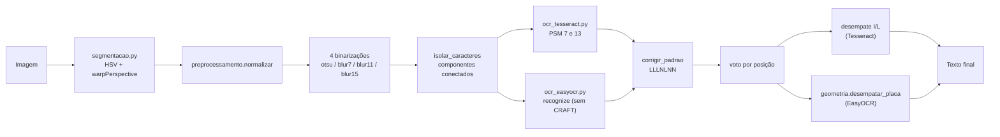

# Documentação de implementação

Detalhamento técnico do pipeline de leitura de placas Mercosul. Para a visão rápida,
veja o [README](../README.md).

## Visão geral

Os dois motores de OCR (Tesseract e EasyOCR) compartilham **toda** a etapa de visão
computacional: segmentação da placa, normalização, binarizações e isolamento dos
caracteres. O que muda é apenas a leitura final e o pós-processamento geométrico.



---

## 1. `src/segmentacao.py` — detecção e retificação

**Objetivo:** localizar todas as placas legíveis da imagem e devolver cada uma já
recortada e corrigida de rotação/perspectiva.

**Estratégia:** a faixa azul superior ("BRASIL") da placa Mercosul é a característica
mais distintiva, então ela é segmentada por cor.

**Passo a passo (`segmentar_placas`)**

1. Converte para HSV.
2. Máscara de azul: `H ∈ [100, 130]`, `S ≥ 120`, `V ≥ 50` (`cv2.inRange`).
3. Máscara da bandeira verde/amarela: `H ∈ [20, 85]` — somada à azul para que a
   bandeira não "corte" a faixa em dois pedaços (`cv2.bitwise_or`).
4. Morfologia: `CLOSE` com kernel retangular `25×3` (fecha os buracos do texto
   "BRASIL" e das estrelas) seguida de `OPEN` `3×3` (remove ruído).
5. `findContours` (`RETR_EXTERNAL`) e, para cada contorno, `minAreaRect`.
6. **Filtros de candidato:** descarta `min(w, h) < 5`; aceita apenas faixas muito
   alongadas e cheias — `12 ≤ razão ≤ 40` e `preenchimento (área/retângulo) > 0.8`.
   Isso separa a faixa da placa de uma carroceria azul qualquer.
7. Ordena os candidatos da maior para a menor largura.
8. **Descarte de placas distantes:** ignora larguras menores que
   `LARGURA_MIN_REL_IMAGEM = 0.15` da largura da imagem **ou**
   `LARGURA_MIN_REL_MAIOR = 0.40` da maior faixa encontrada.
9. Valida o corpo da placa com `_corpo_claro`: a região entre 40 % e 80 % da altura
   deve ter pixels claros (`média(corpo > percentil 40) > 0.25` e `média(corpo) > 70`).
   A **maior** placa é sempre aceita como fallback; as demais precisam passar nesse teste.

**Retificação (`_recortar`)**

1. `boxPoints` + `_ordenar_pontos` colocam os 4 cantos em topo-esq, topo-dir,
   base-dir, base-esq (usando soma e diferença das coordenadas).
2. A partir do vetor da faixa (topo-esq → topo-dir) calcula-se o vetor unitário
   perpendicular "para baixo" (garantindo `baixo.y ≥ 0`).
3. A altura da placa é estimada como `espessura_da_faixa × ALTURA_SOBRE_FAIXA`
   (`ALTURA_SOBRE_FAIXA = 5.0`), pois a proporção largura/altura varia no dataset.
4. `warpPerspective` mapeia o quadrilátero estimado para uma imagem de
   `620 × H` (com `H = 620 * altura / largura`).

**Limitações / pontos calibrados**

- Depende da existência da faixa azul (placas cinzas antigas não são detectadas).
- `LARGURA_MIN_REL_*`, `ALTURA_SOBRE_FAIXA` e os limiares do `_corpo_claro` foram
  calibrados nas 20 imagens do dataset.

`segmentar_placa` é um wrapper de compatibilidade que devolve só a maior placa.

---

## 2. `src/preprocessamento.py` — normalização, binarização e isolamento

**Objetivo:** transformar o recorte da placa em uma linha de texto limpa, pronta para o
OCR, e devolver também a máscara de cada caractere (usada no desempate geométrico).

**`normalizar(placa_bgr)`**

1. Recorta a ROI dos caracteres: `y ∈ [23 %, 80 %]`, `x ∈ [8 %, 99 %]` — remove a
   faixa azul, o "BR" e as bordas pretas.
2. Converte para escala de cinza e amplia 2× (`INTER_CUBIC`) para dar resolução ao OCR.
3. Remove gradientes de iluminação dividindo a imagem pelo fundo estimado: fechamento
   morfológico com elipse `61×61`, suavizado por gaussiana `31×31`, e `cv2.divide(..., scale=255)`.
   Sombras e reflexos somem, o contraste dos glifos é preservado.

**`binarizar(cinza, variante)`** — 4 variantes (`VARIANTES`):

| Variante | Pré-processamento antes do Otsu | Papel |
|----------|----------------------------------|-------|
| `otsu`   | CLAHE (`clipLimit=2.0`, tiles `4×4`) + `bilateralFilter(7, 50, 50)` | realce local de contraste |
| `blur7`  | gaussiana `7×7`  | apaga marca d'água fina |
| `blur11` | gaussiana `11×11` | apaga marca d'água média |
| `blur15` | gaussiana `15×15` | apaga marca d'água forte |

Todas usam `THRESH_BINARY + THRESH_OTSU`. Se a média ficar abaixo de 127, a imagem é
invertida para garantir **texto escuro sobre fundo claro**. Cada variante erra em
placas diferentes — por isso o OCR lê todas e vota.

**`_fundir_empilhados(caixas)`**

Une fragmentos do mesmo caractere partido na vertical (ex.: dígito cortado por sombra).
Funde dois componentes quando há forte sobreposição horizontal
(`interseção ≥ 60 %` do menor) e pouca distância vertical (`gap ≤ 15`). Repete até
estabilizar (fusão transitiva).

**`isolar_caracteres(binaria)`**

1. `connectedComponentsWithStats` sobre o inverso da binária (conectividade 8), para
   tratar a tinta dos glifos como componentes.
2. Mantém componentes com `área > 40`, `largura ≤ 30 % W` e `altura ≤ 98 % H`
   (descarta fundo e barras inteiras).
3. Aplica `_fundir_empilhados`.
4. Filtra por forma: altura `≥ 30 % H` e largura `≥ 0.28 × altura` (remove barras e
   fragmentos finos).
5. Filtro de consistência pela mediana das alturas: mantém caixas entre `0.70×` e
   `1.30×` a mediana (descarta o que destoa, ex.: pedaço de borda).
6. Ordena por `x0` e reconstrói uma imagem limpa (texto preto em fundo branco),
   recortando margens e adicionando borda branca de 20 px.
7. Retorna `(linha_de_texto, máscaras)` onde cada máscara é o recorte binário do
   caractere, na ordem da esquerda para a direita.

---

## 3. `src/pipeline.py` — laço comum

**Objetivo:** compartilhar o laço de processamento entre os dois OCRs. A função de OCR é
injetada (`ler_placa`), então a mesma orquestração serve a Tesseract e EasyOCR.

**`processar_dataset(ler_placa, nome_saida)`**

1. Lista `dataset/` (`.jpg/.jpeg/.png`) e ordena por `chave_numerica` (numérico quando o
   nome é um número, senão alfabético).
2. Se recebido `script.py ini fim`, restringe ao intervalo de imagens.
3. Para cada imagem: `segmentar_placas` → para cada placa:
   - `normalizar` → `ler_placa(cinza)` → `(leituras_brutas, texto_final)`;
   - grava uma linha TSV `arquivo \t leituras_brutas(|) \t texto_final`.
4. Imagem sem placa gera a linha `NAO_ENCONTRADA`.
5. **Artefatos de debug** em `results/debug/`: `_placa.png` (recorte retificado),
   `_binaria.png` (linha binarizada de referência, `blur7`) e `_deteccao.jpg`
   (imagem original com a caixa da placa desenhada). Placas múltiplas recebem sufixo `_pK`.
6. Ao rodar por intervalo, **mescla** as novas linhas com o arquivo existente,
   substituindo apenas os arquivos reprocessados.

---

## 4. `src/ocr_tesseract.py` — OCR com Tesseract

**Objetivo:** ler a linha isolada com o Tesseract, combinar leituras e corrigir o padrão.

**`ler_placa(cinza_normalizada)`**

1. Para cada uma das 4 variantes, binariza e isola a linha; guarda as máscaras da
   variante `blur7` (`mascaras_ref`) para o desempate.
2. Lê a linha com **dois modos** de segmentação (`PSMS = (7, 13)`):
   - `psm 7`: uma única linha de texto;
   - `psm 13`: linha "crua", sem heurísticas de página.
   Total de **8 leituras brutas** (4 variantes × 2 PSM).
3. Config: `--oem 3` (motor LSTM) e `tessedit_char_whitelist` limitada a
   `ALFABETO` (A–Z, 0–9). A saída é limpa com regex `[^A-Z0-9]`.
4. Cada leitura passa por `corrigir_padrao` (padrão Mercosul `LLLNLNN`).
5. **Voto por posição:** só entram leituras com exatamente 7 caracteres; em cada
   posição escolhe-se o caractere mais frequente (`Counter`).
6. **Fallback:** se nenhuma leitura tiver 7 caracteres, devolve a mais longa.
7. **Desempate `I`/`L`:** apenas quando há exatamente 7 máscaras, nas posições de letra,
   mede-se a largura de tinta nos 15 % superiores do glifo (`_largura_topo`): acima de
   `0.45` → `I` (tem serifa no topo), senão `L`.

**Observação:** o desempate geométrico completo de `src/geometria.py` (Y/V, Q/O, 2/7, 1/4)
**não** está ligado a este pipeline; aqui só existe o caso `I`/`L`.

---

## 5. `src/ocr_easyocr.py` — OCR com EasyOCR

**Objetivo:** mesma leitura isolada, agora com o EasyOCR, reaproveitando segmentação e
pré-processamento.

**`obter_leitor()`**

Cria o `easyocr.Reader(["en"], gpu=False, verbose=False)` **uma vez** (singleton global).
O import é tardio e a primeira execução baixa os pesos do modelo. `gpu=False` mantém a
execução em CPU (compatível com máquinas sem CUDA).

**`_ler_linha(img)`**

1. Converte a linha cinza para BGR (o EasyOCR espera 3 canais).
2. Chama `recognize` com `horizontal_list=[[0, w, 0, h]]` e `free_list=[]`, o que **pula
   o detector CRAFT** — a imagem já é apenas a linha de texto.
3. `allowlist=ALFABETO` e `detail=0` (só o texto, sem caixas/confiança).
4. Remove tudo que não seja `A–Z/0–9`.

**`ler_placa(cinza_normalizada)`**

1. Para cada uma das 4 variantes: binariza, isola e lê → **4 leituras brutas**
   (uma por variante, sem PSM). Guarda as máscaras da variante `blur7`.
2. Aplica `corrigir_padrao`, voto por posição entre as leituras de 7 caracteres e o
   mesmo fallback da mais longa do Tesseract.
3. **Desempate geométrico completo:** chama `geometria.desempatar_placa` com as máscaras
   de `blur7` e o padrão `LLLNLNN` (cobre I/L, Y/V, Q/O, 2/7 e 1/4).

### Diferenças entre os dois OCRs

| Aspecto                    | Tesseract                         | EasyOCR                              |
|----------------------------|-----------------------------------|--------------------------------------|
| Leituras por placa         | 8 (4 variantes × PSM 7 e 13)      | 4 (1 por variante)                   |
| Motor                      | binário do sistema (`pytesseract`) | modelo neural (PyTorch), `gpu=False` |
| Detector de texto          | —                                 | desativado (sem CRAFT)               |
| Desempate geométrico       | só `I`/`L` (`_largura_topo`)      | completo (`desempatar_placa`)        |
| Primeira execução          | imediata                          | baixa os pesos do modelo             |

---

## 6. `src/geometria.py` — desempate pela forma do glifo

**Objetivo:** corrigir pares de caracteres que os OCRs confundem de forma consistente,
usando a forma da máscara binária já segmentada (não o texto do OCR).

**Por que existe:** `I/L`, `Y/V`, `Q/O`, `7/2` e `4/1` têm aparência próxima na fonte da
placa, e o OCR erra sempre para o mesmo lado. A geometria do glifo desempata com uma
medida simples de tinta.

**Medidas auxiliares**

- `_largura(m, a, b)`: fração das **colunas** do glifo cobertas por tinta nas linhas
  entre `a·h` e `b·h`. Indica "quão larga" é a tinta numa faixa vertical.
- `_razao_inferior_direita(m)`: tinta no canto inferior-direito dividida pela do
  inferior-esquerdo — a cauda do `Q` eleva essa razão.

**Regras (`desempatar(caractere, mascara, tipo)`)**

Guarda inicial: se `largura/altura > 1.6`, a máscara é larga demais para um caractere
(provável fragmento de borda colado) e nada é alterado. `base` é a largura de tinta nos
15 % inferiores do glifo.

| Posição (`tipo`) | Par   | Decisão                                                        |
|------------------|-------|----------------------------------------------------------------|
| Letra (`L`)      | I / L | `I` se largura de tinta nos 15 % do topo `> 0.45` (serifa), senão `L` |
| Letra (`L`)      | Y / V | `Y` se largura nos 85–95 % da altura `< 0.42` (haste estreita), senão `V` |
| Letra (`L`)      | O / Q | `Q` se `_razao_inferior_direita > 1.08` (cauda), senão `O`       |
| Número (`N`)     | 7 / 2 | `7` se `base < 0.6` (base estreita), senão `2`                 |
| Número (`N`)     | 1 / 4 | `4` se `base < 0.6` (sem barra de base), senão `1`             |

**`desempatar_placa(texto, mascaras, padrao)`**

Só atua quando há exatamente **7 caracteres e 7 máscaras** (alinhamento posição a
posição é confiável). Aplica `desempatar` em cada posição usando `tipo = "L"` se o
padrão for letra, senão `"N"`.

**Limitações:** todos os limiares (0.45, 0.42, 1.08, 0.6, 1.6) foram calibrados nas 20
imagens do dataset (fonte única), então são sensíveis a mudanças de fonte/escala.

---

## 7. `src/utils/ocr_utils.py` — utilitários compartilhados

- `ALFABETO = "ABCDEFGHIJKLMNOPQRSTUVWXYZ0123456789"`: whitelist/allowlist dos OCRs.
- `PADRAO = "LLLNLNN"`: formato Mercosul (`ABC1D23`, `L` = letra, `N` = número).
- `PARA_LETRA` / `PARA_NUMERO`: mapas de confusão usados na correção.
- `corrigir_padrao(texto)`:
  1. limpa para `A–Z/0–9`;
  2. se não tiver 7 caracteres, devolve como está;
  3. caso contrário, força cada posição: em posição `L` converte dígito para letra
     (`PARA_LETRA`) e em posição `N` converte letra para número (`PARA_NUMERO`).

---

## 8. Contratos das funções públicas

| Função | Entrada | Saída |
|--------|---------|-------|
| `segmentacao.segmentar_placas` | `img_bgr` | `[(placa_bgr, caixa_src), ...]` (maior → menor) |
| `segmentacao.segmentar_placa` | `img_bgr` | `(placa_bgr, caixa)` ou `(None, None)` |
| `preprocessamento.normalizar` | `placa_bgr` | `cinza_normalizada` |
| `preprocessamento.binarizar` | `cinza`, `variante` | `binaria` (texto escuro / fundo claro) |
| `preprocessamento.isolar_caracteres` | `binaria` | `(linha_texto, [mascaras])` |
| `pipeline.processar_dataset` | `ler_placa`, `nome_saida` | grava `results/<nome_saida>` |
| `ocr_tesseract.ler_placa` | `cinza_normalizada` | `(leituras_brutas, texto_final)` |
| `ocr_easyocr.ler_placa` | `cinza_normalizada` | `(leituras_brutas, texto_final)` |
| `geometria.desempatar_placa` | `texto`, `mascaras`, `padrao` | `texto` corrigido |
| `ocr_utils.corrigir_padrao` | `texto` | `texto` no padrão `LLLNLNN` |

## 9. Limiares calibrados

| Constante / limiar | Valor | Arquivo |
|--------------------|-------|---------|
| Faixa azul HSV | H 100–130, S ≥ 120, V ≥ 50 | `segmentacao.py` |
| Faixa da bandeira HSV | H 20–85, S ≥ 100, V ≥ 80 | `segmentacao.py` |
| Kernel de fechamento | `25×3` | `segmentacao.py` |
| Razão / preenchimento da faixa | 12–40 / > 0.8 | `segmentacao.py` |
| Largura mínima relativa | 15 % da imagem, 40 % da maior | `segmentacao.py` |
| Altura da placa sobre a faixa | 5.0× | `segmentacao.py` |
| Largura do recorte retificado | 620 px | `segmentacao.py` |
| ROI dos caracteres | y 23–80 %, x 8–99 % | `preprocessamento.py` |
| Fundo estimado | elipse 61×61 + blur 31×31 | `preprocessamento.py` |
| CLAHE | clip 2.0, tiles 4×4 | `preprocessamento.py` |
| Fusão de fragmentos | sobreposição ≥ 60 %, gap ≤ 15 | `preprocessamento.py` |
| Consistência de altura | mediana ± 30 % | `preprocessamento.py` |
| PSM do Tesseract | 7 e 13 | `ocr_tesseract.py` |
| Desempate I/L (topo) | 0.45 | `ocr_tesseract.py` |
| Desempate Y/V | 0.42 | `geometria.py` |
| Desempate O/Q | 1.08 | `geometria.py` |
| Desempate 7/2 e 1/4 (base) | 0.6 | `geometria.py` |
| Guarda de máscara larga | w/h > 1.6 | `geometria.py` |

> Os limiares marcados como "calibrados" foram ajustados nas mesmas 20 imagens usadas na
> avaliação; o desempenho em imagens novas pode ser menor.

---

## 10. Desempate geométrico: por que e como funciona hoje

Esta seção consolida a motivação e o comportamento **atual** do desempate geométrico no
código. O walkthrough do módulo está na [seção 6](#6-srcgeometriapy--desempate-pela-forma-do-glifo).

### 10.1 Por que utilizamos

Os dois OCRs acertam a **classe** do caractere (letra ou número), mas confundem de forma
consistente alguns pares **dentro da mesma classe**:

- letras: `I/L`, `Y/V`, `Q/O`;
- números: `7/2`, `1/4`.

Três motivos tornam esse problema relevante e justificam uma etapa dedicada:

1. **A correção de padrão não resolve.** `corrigir_padrao` só troca a classe de acordo com
   o formato `LLLNLNN` (ex.: um `O` em posição numérica vira `0`). Se o `O` foi lido onde
   deveria ser `Q`, trocar a classe não ajuda — o caractere já é uma letra válida.
2. **O voto por posição também não resolve.** Ele escolhe o caractere mais frequente entre
   as 8 (Tesseract) ou 4 (EasyOCR) leituras. Quando o modelo/Tesseract tem viés sistemático
   e **todas** as leituras erram para o mesmo lado, a maioria simplesmente confirma o erro.
3. **A forma do glifo carrega a informação que falta.** Na etapa 2, `isolar_caracteres` já
   devolve a máscara binária de cada caractere. Características simples de distribuição de
   tinta (largura do topo, largura da base, tinta no canto inferior-direito) separam esses
   pares com limiares estáveis para a fonte da placa Mercosul.

No EasyOCR, o desempate levou 13/20 para 21/21 placas exatas no dataset (ressalva: foi
calibrado nas mesmas imagens). No Tesseract ele cobre apenas `I/L` — ver 10.5.

### 10.2 Entradas e pré-condições (código atual)

`geometria.desempatar_placa(texto, mascaras, padrao)` recebe:

| Argumento  | Origem | Papel |
|------------|--------|-------|
| `texto`    | resultado do voto por posição | caracteres a desempatar (7 posições) |
| `mascaras` | `isolar_caracteres` da variante `blur7` | forma binária de cada glifo, na ordem da esquerda para a direita |
| `padrao`   | constante `PADRAO = "LLLNLNN"` | define se a posição é letra (`L`) ou número (`N`) |

A variante `blur7` é usada como referência porque reduz a marca d'água sem borrar demais
os glifos. **Pré-condição:** a função só atua quando há exatamente **7 caracteres e
7 máscaras**; caso contrário devolve o texto original sem alterações (o alinhamento
posição a posição deixa de ser confiável).

### 10.3 Medidas auxiliares

- `_largura(m, a, b)`: fração das **colunas** do glifo com tinta nas linhas entre `a·h` e
  `b·h`. Responde “quão larga é a tinta numa faixa vertical”.
- `_razao_inferior_direita(m)`: tinta na metade direita da faixa inferior (75–100 % da
  altura) dividida pela metade esquerda. A cauda do `Q` eleva essa razão.
- **Guarda inicial:** se `largura/altura > 1.6`, a máscara é larga demais para um caractere
  (provável fragmento de borda colado) e **nada** é alterado.

### 10.4 Regras por par

A regra só é aplicada quando o caractere atual pertence ao par e a posição é compatível
com o `tipo` (`L` = letra, `N` = número). `base` é `_largura(m, 0.85, 1.0)`.

| Par | Tipo | Medida | Decisão |
|-----|------|--------|---------|
| `I/L` | `L` | tinta nos 15 % do topo | `> 0.45` → `I` (serifa); senão `L` |
| `Y/V` | `L` | tinta em 85–95 % da altura | `< 0.42` → `Y` (haste fina); senão `V` |
| `O/Q` | `L` | `_razao_inferior_direita` | `> 1.08` → `Q` (cauda); senão `O` |
| `7/2` | `N` | `base` | `< 0.6` → `7` (base estreita); senão `2` |
| `1/4` | `N` | `base` | `< 0.6` → `4` (sem barra de base); senão `1` |

Pseudocódigo do fluxo:

```python
if mascara_larga(w / h > 1.6):
    return caractere            # fragmento: não mexe
if tipo == "L" and caractere in "IL":
    return "I" if tinta_topo > 0.45 else "L"
if tipo == "L" and caractere in "YV":
    return "Y" if tinta_85_95 < 0.42 else "V"
if tipo == "L" and caractere in "OQ":
    return "Q" if razao_inferior_direita > 1.08 else "O"
if tipo == "N" and caractere in "27":
    return "7" if base < 0.6 else "2"
if tipo == "N" and caractere in "14":
    return "4" if base < 0.6 else "1"
return caractere                # par não coberto: mantém
```

`desempatar_placa` aplica essa rotina em cada uma das 7 posições, escolhendo o `tipo` pelo
`padrao`.

### 10.5 Estado atual da integração

- **EasyOCR (`src/ocr_easyocr.py`)** — integração completa. Depois do voto por posição,
  chama `desempatar_placa("".join(final), mascaras_ref, PADRAO)`, cobrindo os cinco pares.
- **Tesseract (`src/ocr_tesseract.py`)** — **não** usa `src/geometria.py`. Tem um desempate
  inline restrito a `I/L`: mede a tinta nos 15 % superiores do glifo (`_largura_topo`) e
  decide `I` se `> 0.45`, senão `L`, apenas em posições `L`.

**Consequência:** o Tesseract continua sujeito a erros de `Y/V`, `Q/O`, `2/7` e `1/4` que
a geometria já resolveria. Por isso a comparação de acurácia entre os dois motores não é
totalmente justa (o mesmo aviso está no README).

### 10.6 Limitações e riscos

- **Calibração no mesmo dataset.** Todos os limiares (`0.45`, `0.42`, `1.08`, `0.6`, `1.6`)
  foram ajustados nas mesmas 20 imagens da avaliação — risco de *overfit*; em imagens novas
  o desempate pode piorar uma leitura que estava correta.
- **Depende de máscara limpa.** Se `isolar_caracteres` fragmentar ou fundir glifos, as
  medidas de tinta mudam e a decisão pode errar.
- **Exige 7 glifos.** Se a segmentação perder ou sobrar um caractere, o desempate não roda.
- **Específico da fonte Mercosul.** É uma heurística de forma; outra fonte/escala exige
  recalibração das medidas e limiares.

### 10.7 Como estender ao Tesseract (nota)

Para igualar o comportamento do EasyOCR, bastaria, ao final de `ocr_tesseract.ler_placa`,
substituir o bloco inline de `I/L` por uma chamada a
`geometria.desempatar_placa("".join(final), mascaras_ref or [], PADRAO)`. Isso aproveita as
mesmas máscaras de `blur7` já coletadas e habilita os cinco pares. (Indicação de extensão;
não está implementado.)
